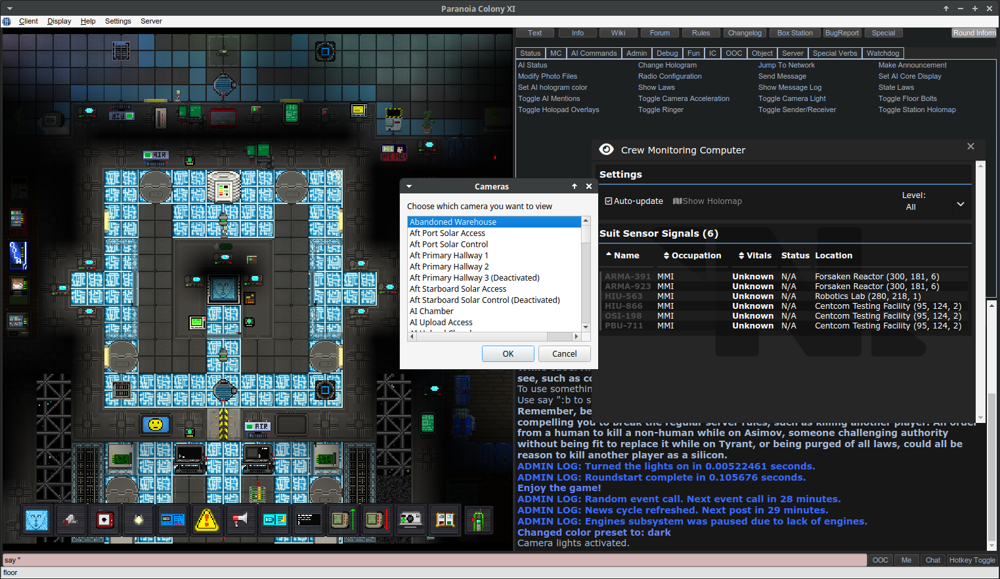

# Fugue

Fugue is a native Linux, macOS and Windows client and launcher for BYOND games, written in C++20 with Qt 6. It replaces DreamSeeker on
servers that run stock BYOND, without a BYOND install and without Wine. It is engineered for /vg/station. It is
unofficial and not affiliated with BYOND.

**Status:** early software. It plays full /vg/station rounds, other BYOND games may work, and bugs are expected.



<sub>/vg/station's art is © its contributors under [CC BY-SA 3.0](https://creativecommons.org/licenses/by-sa/3.0/).</sub>

## Install

Download the latest build from the [releases page](https://github.com/toomykins/fugue/releases/latest):

* **Linux:** install from the Flatpak repository, so `flatpak update` and your software centre keep Fugue current. It uses
  KDE's runtime from Flathub:

  ```bash
  flatpak remote-add --user --if-not-exists flathub https://dl.flathub.org/repo/flathub.flatpakrepo
  flatpak install --user https://toomykins.github.io/fugue/io.github.toomykins.Fugue.flatpakref
  flatpak run io.github.toomykins.Fugue
  ```

  `fugue.flatpak` on the releases page is the same build for offline installs, but it does not update. To switch from it,
  run `flatpak uninstall --user io.github.toomykins.Fugue` and then the install line above; your sign-ins and cache stay.
* **Windows:** `Fugue-windows-x64.zip`. Unzip it and run `Fugue\bin\fugue-qt.exe`. The build is not signed, so Windows
  SmartScreen may ask first: choose "More info", then "Run anyway".
* **macOS:** `Fugue-macos-apple-silicon.zip` or `Fugue-macos-intel.zip`. Unzip it and move `Fugue.app` to Applications.
  The app is not notarized, so the first launch is blocked: open System Settings → Privacy & Security and choose
  "Open Anyway", or run `xattr -dr com.apple.quarantine /Applications/Fugue.app`.

### Build from source

Details and prerequisites are in [docs/BUILDING.md](docs/BUILDING.md):

```bash
cmake -G Ninja -S . -B build -DFUGUE_RELEASE=ON
ninja -C build
```

On macOS, follow the [Homebrew and app bundle instructions](docs/BUILDING.md#macos).
For Windows (MSVC + Qt), see [Windows build and packaging](docs/BUILDING.md#windows-x64).
On Linux, you can also build the Flatpak described in [docs/BUILDING.md](docs/BUILDING.md).

## Run

```bash
build/app/fugue-qt                              # the launcher: server list and sign-in
build/app/fugue-qt client --connect host:port   # the game window, as a guest
```

On macOS, open `build/app/Fugue.app`, or run `build/app/Fugue.app/Contents/MacOS/Fugue` with the same arguments.

All options, state directories and environment variables are in [docs/USAGE.md](docs/USAGE.md).

## Documentation

* [docs/BUILDING.md](docs/BUILDING.md): prerequisites, build options, tests, Flatpak
* [docs/USAGE.md](docs/USAGE.md): launcher and client commands, state directories, environment, audio
* [docs/ARCHITECTURE.md](docs/ARCHITECTURE.md): modules, threads, the HTML surface, the resource cache
* [SECURITY.md](SECURITY.md): what Fugue stores and how it handles your credentials
* [CONTRIBUTING.md](CONTRIBUTING.md): code layout rules, tests, style
* [THIRD-PARTY-NOTICES.md](THIRD-PARTY-NOTICES.md): third-party code and data

## License

The [Unlicense](LICENSE), except the third-party files listed in [THIRD-PARTY-NOTICES.md](THIRD-PARTY-NOTICES.md).
